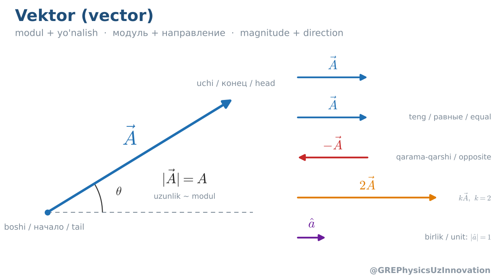
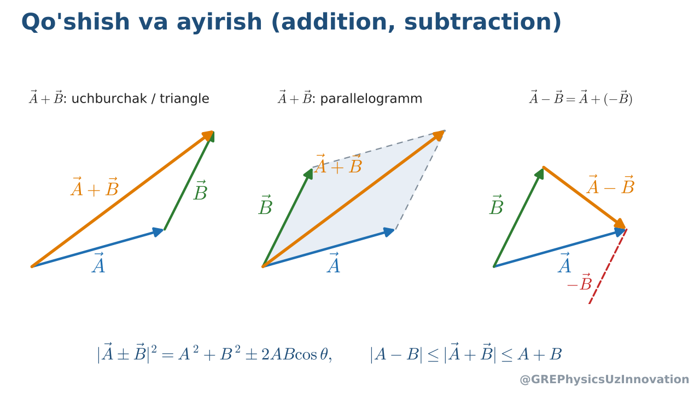
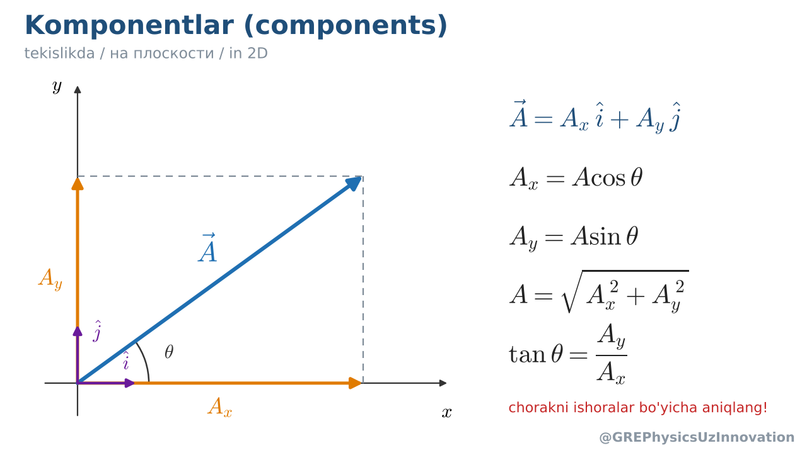
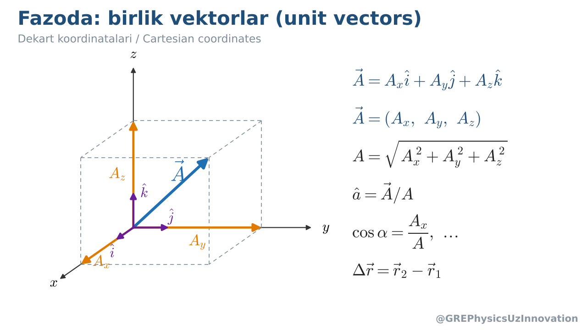
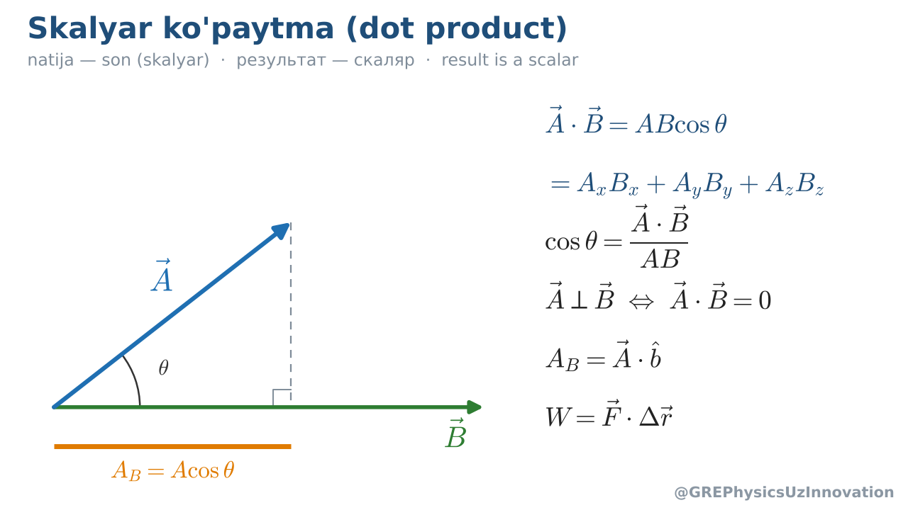
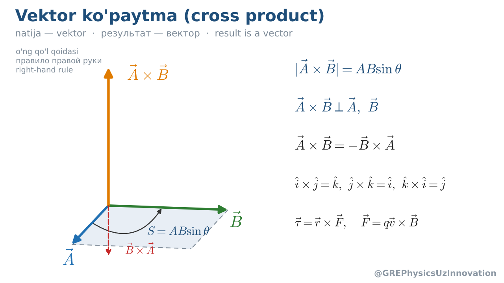

# Vectors

**Goal.** After this lesson you can resolve a vector into components, add and subtract vectors,
compute dot and cross products, and apply them to work, torque and the Lorentz force.

**Role on the GRE.** Vectors are not a separate topic, but they appear in almost every
mechanics (20%) and electromagnetism (18%) question. No calculator is allowed, so fast,
reliable arithmetic and sanity checks matter.
## 1. Scalar and vector quantities

- A **scalar** is fully specified by a number (and unit): mass, time, temperature, energy, work.
- A **vector** has a **magnitude** and a **direction**: displacement, velocity, acceleration, force,
  momentum, field strength.

Notation: $\vec A$ or **A**; magnitude $|\vec A|=A\ge0$. A vector is drawn as an arrow with a
**tail** and a **head** (F01). Zero vector $\vec0$; equal vectors (same magnitude and direction —
a vector may be translated parallel to itself); opposite vector $-\vec A$; **unit vector**
$\hat a=\vec A/|\vec A|$.

## 2. Addition and subtraction

**Head-to-tail (triangle) rule** and **parallelogram rule** (F02). Subtraction:
$\vec A-\vec B=\vec A+(-\vec B)$; for vectors drawn from one point it runs from the head of $\vec B$
to the head of $\vec A$. Scalar multiplication: $|k\vec A|=|k|A$, direction reversed if $k<0$.
Addition is commutative and associative; scalar multiplication is distributive.

**Law of cosines:** $|\vec A\pm\vec B|^2=A^2+B^2\pm2AB\cos\theta$.
**Triangle inequality:** $|A-B|\le|\vec A+\vec B|\le A+B$.

## 3. Components and unit vectors

$\vec A=A_x\hat i+A_y\hat j+A_z\hat k=(A_x,A_y,A_z)$; components are signed scalars;
$A=\sqrt{A_x^2+A_y^2+A_z^2}$. In 2D (angle $\theta$ from the $x$-axis, F03): $A_x=A\cos\theta$,
$A_y=A\sin\theta$, $\tan\theta=A_y/A_x$ (choose the quadrant from the signs).
Direction cosines: $\cos\alpha=A_x/A$, etc., with $\cos^2\alpha+\cos^2\beta+\cos^2\gamma=1$.
Component-wise operations; position vector $\vec r=(x,y,z)$; displacement
$\Delta\vec r=\vec r_2-\vec r_1$ (F04).

## 4. Dot (scalar) product

$$\vec A\cdot\vec B=AB\cos\theta=A_xB_x+A_yB_y+A_zB_z$$ — a **scalar**.
Commutative and distributive; $\vec A\cdot\vec A=A^2$; $\vec A\perp\vec B\iff\vec A\cdot\vec B=0$;
$\hat i\cdot\hat i=1$, $\hat i\cdot\hat j=0$. Angle: $\cos\theta=\vec A\cdot\vec B/(AB)$.
Projection (F05): $A_B=\vec A\cdot\hat b=A\cos\theta$, vector projection $(\vec A\cdot\hat b)\hat b$.
Physics: work $W=\vec F\cdot\Delta\vec r$, power $P=\vec F\cdot\vec v$, flux $\Phi=\vec B\cdot\vec S$.

## 5. Cross (vector) product

$\vec A\times\vec B$ is a **vector** of magnitude $AB\sin\theta$ (parallelogram area), perpendicular to
both factors, direction by the **right-hand rule** (F06).

$$\vec A\times\vec B=\begin{vmatrix}\hat i&\hat j&\hat k\\ A_x&A_y&A_z\\ B_x&B_y&B_z\end{vmatrix}
=(A_yB_z-A_zB_y)\hat i+(A_zB_x-A_xB_z)\hat j+(A_xB_y-A_yB_x)\hat k .$$

Anticommutative $\vec A\times\vec B=-\vec B\times\vec A$; $\vec A\times\vec A=\vec0$; distributive;
$\hat i\times\hat j=\hat k$, $\hat j\times\hat k=\hat i$, $\hat k\times\hat i=\hat j$ (reverse order gives
a minus sign). Physics: torque $\vec\tau=\vec r\times\vec F$, angular momentum $\vec L=\vec r\times\vec p$,
Lorentz force $\vec F=q\vec v\times\vec B$, $\vec v=\vec\omega\times\vec r$.

## 6. Triple products

Scalar triple product $\vec A\cdot(\vec B\times\vec C)$ = determinant of the components; its absolute
value is the parallelepiped volume; zero means coplanar; invariant under cyclic permutation.
Vector triple product ("BAC − CAB"): $\vec A\times(\vec B\times\vec C)=\vec B(\vec A\cdot\vec C)-\vec C(\vec A\cdot\vec B)$.
## 7. Quick GRE checks

Check the sign (acute vs obtuse angle); a cross product must be perpendicular to both factors;
test limits $\theta=0$ and $90^\circ$; $|\vec A+\vec B|$ lies in $[|A-B|,A+B]$; watch for "nice"
triples $3\!-\!4\!-\!5$, $1\!-\!2\!-\!2$, $2\!-\!3\!-\!6$; order matters in $\vec r\times\vec F$ and $q\vec v\times\vec B$.

