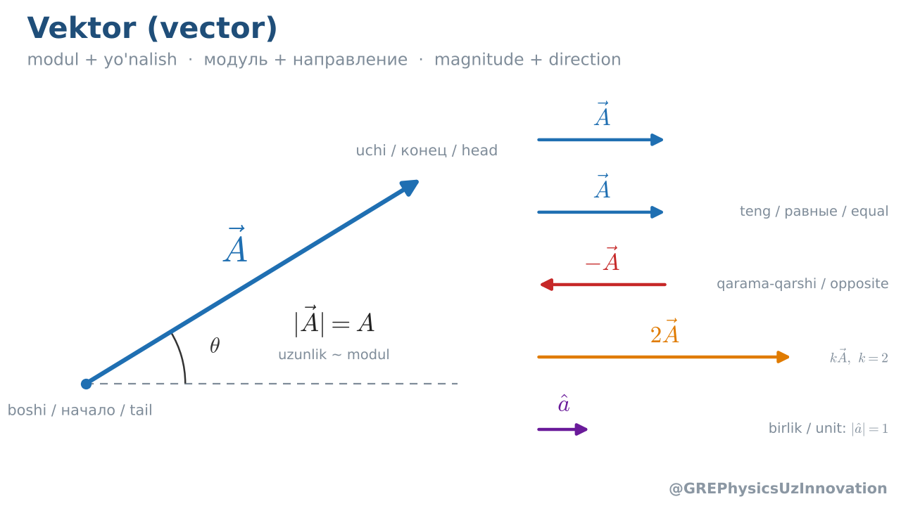
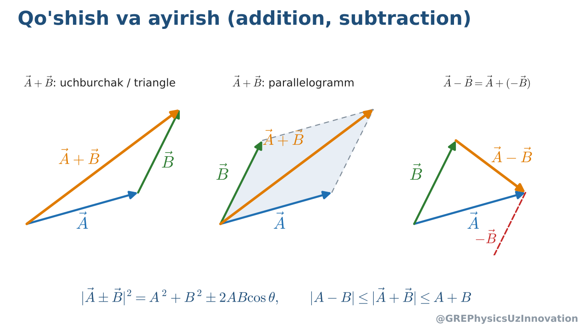
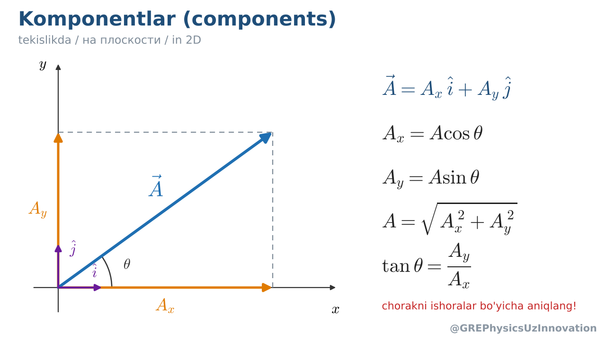
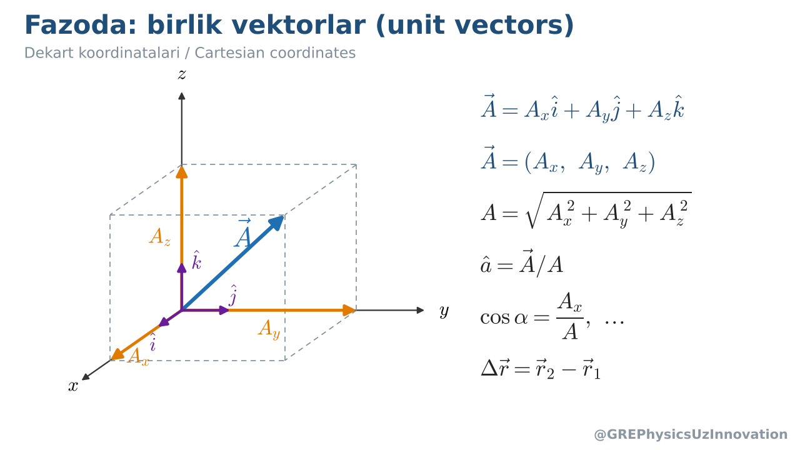
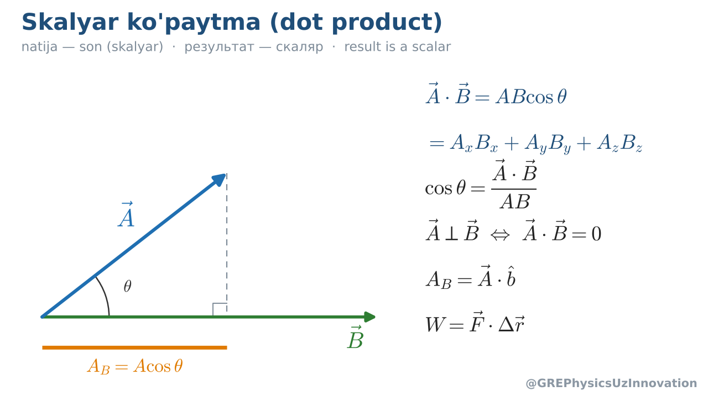
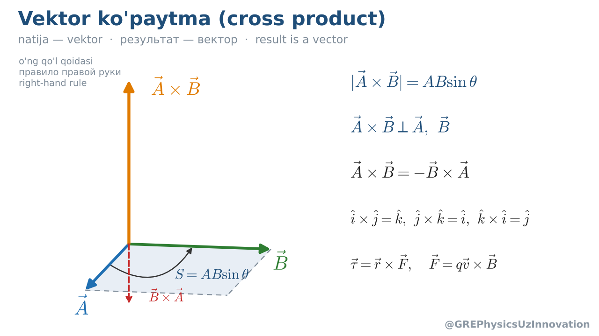

# Векторы

**Цель.** После урока вы сможете раскладывать вектор на компоненты, складывать и вычитать
векторы, вычислять скалярное и векторное произведения и применять их к работе, моменту силы
и силе Лоренца.

**Роль в GRE.** Векторы — не отдельный раздел, но используются почти во всех задачах по
механике (20%) и электромагнетизму (18%). Калькулятора нет, поэтому важно считать быстро и
уметь проверять ответ.
## 1. Скалярные и векторные величины

- **Скалярная величина** полностью задаётся числом (и единицей): масса, время, температура, энергия, работа.
- **Векторная величина** задаётся **модулем** и **направлением**: перемещение, скорость,
  ускорение, сила, импульс, напряжённость поля.

Обозначение: $\vec A$ или **A**; модуль $|\vec A|=A\ge0$. Вектор изображается стрелкой с
**началом** и **концом** (F01).

- **Нулевой вектор** $\vec 0$ — модуль 0, направление не определено.
- **Равные векторы** — одинаковые модуль и направление (вектор можно переносить параллельно).
- **Противоположный вектор** $-\vec A$ — тот же модуль, обратное направление.
- **Единичный вектор** $\hat a=\vec A/|\vec A|$ — модуль 1, задаёт только направление.

## 2. Сложение и вычитание векторов

**Правило треугольника:** начало $\vec B$ совмещаем с концом $\vec A$; $\vec A+\vec B$ идёт из
начала $\vec A$ в конец $\vec B$. **Правило параллелограмма:** сумма — диагональ параллелограмма,
построенного на векторах, выходящих из одной точки.

**Вычитание:** $\vec A-\vec B=\vec A+(-\vec B)$; для векторов из одной точки — вектор из конца
$\vec B$ в конец $\vec A$ (F02). **Умножение на число:** модуль $k\vec A$ равен $|k|A$; при $k<0$
направление меняется на противоположное.

**Свойства:** коммутативность, ассоциативность, дистрибутивность.

**Теорема косинусов:** $|\vec A\pm\vec B|^2=A^2+B^2\pm2AB\cos\theta$.
**Неравенство треугольника:** $|A-B|\le|\vec A+\vec B|\le A+B$.

## 3. Компоненты и орты

Орты осей: $\hat i,\hat j,\hat k$. $\ \vec A=A_x\hat i+A_y\hat j+A_z\hat k=(A_x,A_y,A_z)$;
компоненты — скаляры (могут быть отрицательными). **Модуль:** $A=\sqrt{A_x^2+A_y^2+A_z^2}$.

**На плоскости** (угол $\theta$ с осью $x$, F03): $A_x=A\cos\theta$, $A_y=A\sin\theta$,
$\tan\theta=A_y/A_x$ (четверть определяйте по знакам компонент).

**Направляющие косинусы:** $\cos\alpha=A_x/A$, $\cos\beta=A_y/A$, $\cos\gamma=A_z/A$,
$\cos^2\alpha+\cos^2\beta+\cos^2\gamma=1$.

**Действия в компонентах** — по каждой оси отдельно. **Радиус-вектор** $\vec r=(x,y,z)$;
**перемещение** $\Delta\vec r=\vec r_2-\vec r_1$ (F04).

## 4. Скалярное произведение

$$\vec A\cdot\vec B=AB\cos\theta=A_xB_x+A_yB_y+A_zB_z$$ — результат **скаляр**.

Свойства: коммутативно, дистрибутивно; $\vec A\cdot\vec A=A^2$;
$\vec A\perp\vec B\iff\vec A\cdot\vec B=0$; $\hat i\cdot\hat i=1$, $\hat i\cdot\hat j=0$ и т.д.
Знак: $+$ при $\theta<90^\circ$, $0$ при $90^\circ$, $-$ при $\theta>90^\circ$.

**Угол:** $\cos\theta=\vec A\cdot\vec B/(AB)$. **Проекция** (F05): $A_B=\vec A\cdot\hat b=A\cos\theta$;
векторная проекция $(\vec A\cdot\hat b)\hat b$.

**В физике:** работа $W=\vec F\cdot\Delta\vec r$, мощность $P=\vec F\cdot\vec v$, поток $\Phi=\vec B\cdot\vec S$.

## 5. Векторное произведение

$\vec C=\vec A\times\vec B$ — **вектор**: модуль $AB\sin\theta$ (площадь параллелограмма),
направление перпендикулярно $\vec A$ и $\vec B$ по **правилу правой руки** (F06).

$$\vec A\times\vec B=\begin{vmatrix}\hat i&\hat j&\hat k\\ A_x&A_y&A_z\\ B_x&B_y&B_z\end{vmatrix}
=(A_yB_z-A_zB_y)\hat i+(A_zB_x-A_xB_z)\hat j+(A_xB_y-A_yB_x)\hat k .$$

Свойства: $\vec A\times\vec B=-\vec B\times\vec A$ (антикоммутативность); $\vec A\times\vec A=\vec0$;
дистрибутивность; $\hat i\times\hat j=\hat k$, $\hat j\times\hat k=\hat i$, $\hat k\times\hat i=\hat j$
(в обратном порядке — знак «−»).

**В физике:** момент силы $\vec\tau=\vec r\times\vec F$, момент импульса $\vec L=\vec r\times\vec p$,
сила Лоренца $\vec F=q\vec v\times\vec B$, $\vec v=\vec\omega\times\vec r$.

## 6. Тройные произведения

**Смешанное произведение** $\vec A\cdot(\vec B\times\vec C)$ = определитель из компонент;
модуль — объём параллелепипеда; ноль — векторы компланарны; не меняется при циклической
перестановке. **Двойное векторное произведение («BAC − CAB»):**
$\vec A\times(\vec B\times\vec C)=\vec B(\vec A\cdot\vec C)-\vec C(\vec A\cdot\vec B)$.
## 7. Быстрые проверки для GRE

Проверяйте знак (острый/тупой угол); результат векторного произведения должен быть
перпендикулярен обоим множителям; предельные случаи $\theta=0$ и $90^\circ$; модуль суммы лежит в
$[|A-B|,A+B]$; «удобные» тройки $3\!-\!4\!-\!5$, $1\!-\!2\!-\!2$, $2\!-\!3\!-\!6$; порядок множителей
в $\vec r\times\vec F$ и $q\vec v\times\vec B$ важен.

