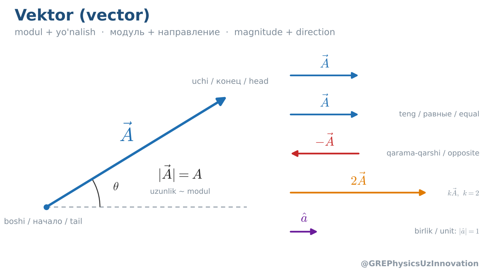
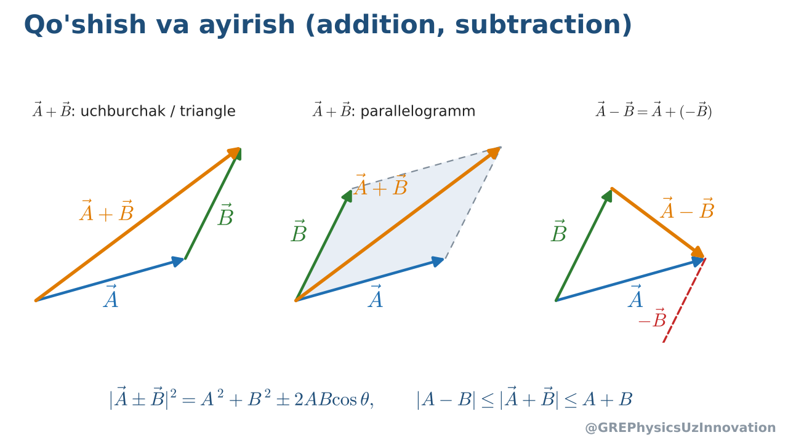
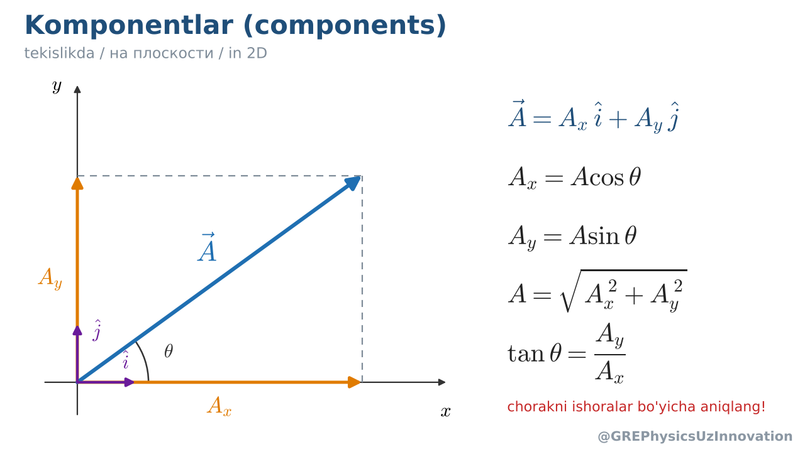
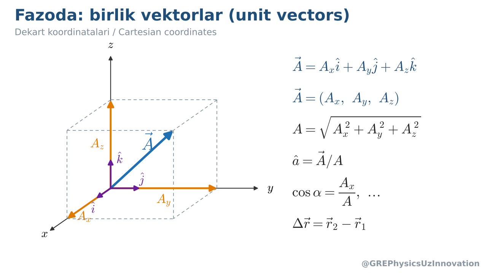
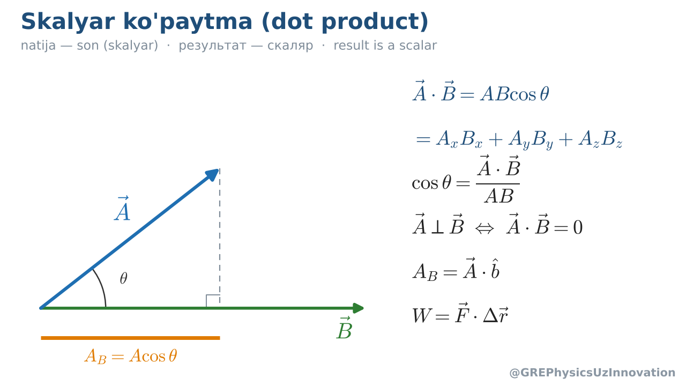
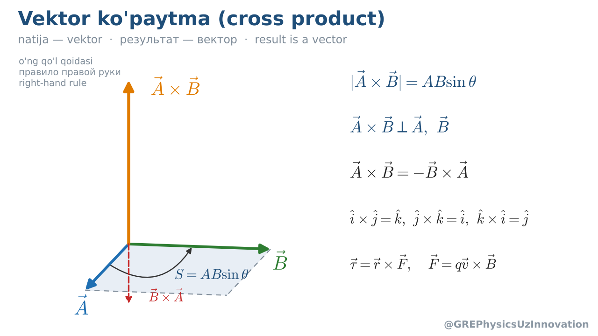

# Vektorlar (Vectors)

**Maqsad.** Dars oxirida siz: vektorni komponentlarga ajratasiz, vektorlarni qo'shasiz va
ayirasiz, skalyar (dot) va vektor (cross) ko'paytmani hisoblaysiz hamda ularni ish, kuch
momenti va Lorens kuchi kabi fizik kattaliklarga qo'llaysiz.

**GRE'da o'rni.** Vektorlar alohida bo'lim emas, lekin mexanika (20%) va
elektromagnetizm (18%) savollarining deyarli hammasida ishlatiladi. Kalkulyator yo'q —
shuning uchun hisobni tez va xatosiz qilish, javobni tekshirish usullarini bilish muhim.

## 1. Skalyar va vektor kattaliklar (Scalar and vector quantities)

- **Skalyar kattalik (scalar)** — faqat son qiymati (va birligi) bilan to'liq aniqlanadi:
  massa, vaqt, temperatura, energiya, ish.
- **Vektor kattalik (vector)** — son qiymati (**modul, magnitude**) va **yo'nalishi
  (direction)** bilan aniqlanadi: ko'chish, tezlik, tezlanish, kuch, impuls, maydon kuchlanganligi.

Belgilash: $\vec A$ (qo'lda) yoki **A** (kitobda, qalin harf). Modul: $|\vec A| = A \ge 0$.

Vektor strelka bilan tasvirlanadi: **boshi (tail)** va **uchi (head)** bor, uzunligi modulga
proporsional (F01).

- **Nol vektor (zero vector)** $\vec 0$: moduli 0, yo'nalishi aniqlanmagan.
- **Teng vektorlar (equal vectors)**: moduli va yo'nalishi bir xil (boshining qayerdaligi muhim emas
  — vektorni o'ziga parallel ko'chirish mumkin).
- **Qarama-qarshi vektor (opposite vector)** $-\vec A$: moduli bir xil, yo'nalishi teskari.
- **Birlik vektor (unit vector)** $\hat a = \vec A / |\vec A|$: moduli 1, faqat yo'nalishni bildiradi.

## 2. Vektorlarni qo'shish va ayirish (Vector addition and subtraction)

**Uchburchak qoidasi (triangle / head-to-tail rule):** $\vec B$ ning boshini $\vec A$ ning uchiga
qo'yamiz; $\vec A+\vec B$ — $\vec A$ ning boshidan $\vec B$ ning uchiga o'tkazilgan vektor.

**Parallelogramm qoidasi (parallelogram rule):** ikkala vektor bir nuqtadan chiqariladi;
yig'indi — shu nuqtadan chiqqan parallelogramm diagonali.

**Ayirish (subtraction):** $\vec A-\vec B=\vec A+(-\vec B)$. Bir nuqtadan chiqarilgan vektorlar uchun
$\vec A-\vec B$ — $\vec B$ ning uchidan $\vec A$ ning uchiga yo'nalgan vektor (F02).

**Skalyarga ko'paytirish (scalar multiplication):** $k\vec A$ ning moduli $|k|A$; $k>0$ bo'lsa yo'nalish
saqlanadi, $k<0$ bo'lsa teskari bo'ladi.

**Xossalar (properties):**
$\vec A+\vec B=\vec B+\vec A$ (o'rin almashtirish, commutative);
$(\vec A+\vec B)+\vec C=\vec A+(\vec B+\vec C)$ (guruhlash, associative);
$k(\vec A+\vec B)=k\vec A+k\vec B$ (taqsimot, distributive).

**Kosinuslar teoremasi (law of cosines):** $\vec A$ va $\vec B$ orasidagi burchak $\theta$ bo'lsa,
$$|\vec A+\vec B|^2=A^2+B^2+2AB\cos\theta,\qquad |\vec A-\vec B|^2=A^2+B^2-2AB\cos\theta .$$

**Uchburchak tengsizligi (triangle inequality):** $|A-B|\le|\vec A+\vec B|\le A+B$.
GRE'da "qaysi qiymat bo'lishi mumkin emas?" turidagi savollar shunga quriladi.

## 3. Komponentlar va birlik vektorlar (Components and unit vectors)

Dekart koordinatalar sistemasida (Cartesian coordinates) $x, y, z$ o'qlari bo'ylab birlik vektorlar
$\hat i,\ \hat j,\ \hat k$ (ba'zan $\hat x,\hat y,\hat z$). Har qanday vektor:
$$\vec A=A_x\hat i+A_y\hat j+A_z\hat k=(A_x,\,A_y,\,A_z).$$
$A_x, A_y, A_z$ — **komponentlar (components)**, ular skalyar sonlar (manfiy bo'lishi mumkin).

**Modul:** $A=\sqrt{A_x^2+A_y^2+A_z^2}$.

**Tekislikda (2D):** vektor $x$ o'qi bilan $\theta$ burchak hosil qilsa (F03),
$$A_x=A\cos\theta,\qquad A_y=A\sin\theta,\qquad \tan\theta=\frac{A_y}{A_x}.$$
Diqqat: $\tan\theta=A_y/A_x$ dan burchak topilganda chorakni (quadrant) $A_x, A_y$ ishoralariga
qarab aniqlang.

**Yo'naltiruvchi kosinuslar (direction cosines):** $\cos\alpha=A_x/A,\ \cos\beta=A_y/A,\
\cos\gamma=A_z/A$; $\ \cos^2\alpha+\cos^2\beta+\cos^2\gamma=1$. Ular birlik vektor komponentlaridir:
$\hat a=(\cos\alpha,\cos\beta,\cos\gamma)$.

**Komponentlarda amallar** — "har bir o'q alohida":
$\vec A\pm\vec B=(A_x\pm B_x,\ A_y\pm B_y,\ A_z\pm B_z)$, $\ k\vec A=(kA_x,\ kA_y,\ kA_z)$.

**Radius-vektor va ko'chish (position vector, displacement):** nuqta $P(x,y,z)$ ning radius-vektori
$\vec r=(x,y,z)$; $P_1$ dan $P_2$ ga ko'chish $\Delta\vec r=\vec r_2-\vec r_1$.

## 4. Skalyar ko'paytma (Dot product, scalar product)

**Ta'rif:**
$$\vec A\cdot\vec B=AB\cos\theta=A_xB_x+A_yB_y+A_zB_z ,$$
natija — **skalyar** son. $\theta$ — vektorlar orasidagi burchak ($0\le\theta\le\pi$).

**Xossalar:**
- $\vec A\cdot\vec B=\vec B\cdot\vec A$; $\ \vec A\cdot(\vec B+\vec C)=\vec A\cdot\vec B+\vec A\cdot\vec C$.
- $\vec A\cdot\vec A=A^2$.
- $\vec A\perp\vec B \iff \vec A\cdot\vec B=0$ (perpendikulyarlik sharti, orthogonality).
- $\hat i\cdot\hat i=\hat j\cdot\hat j=\hat k\cdot\hat k=1$, $\ \hat i\cdot\hat j=\hat j\cdot\hat k=\hat k\cdot\hat i=0$.
- Ishora: $\theta<90^\circ$ da musbat, $\theta=90^\circ$ da nol, $\theta>90^\circ$ da manfiy.

**Burchakni topish:** $\cos\theta=\dfrac{\vec A\cdot\vec B}{AB}$.

**Proyeksiya (projection, F05):** $\vec A$ ning $\vec B$ yo'nalishidagi skalyar proyeksiyasi
(komponenti) $A_B=\vec A\cdot\hat b=A\cos\theta$; vektor proyeksiyasi
$\vec A_{\parallel}=(\vec A\cdot\hat b)\,\hat b$. Xususan $A_x=\vec A\cdot\hat i$.

**Fizikada:** o'zgarmas kuch ishi (work) $W=\vec F\cdot\Delta\vec r$; quvvat (power)
$P=\vec F\cdot\vec v$; magnit oqimi (magnetic flux) $\Phi=\vec B\cdot\vec S$.

## 5. Vektor ko'paytma (Cross product, vector product)

**Ta'rif:** $\vec C=\vec A\times\vec B$ — **vektor**, uning
- moduli $|\vec A\times\vec B|=AB\sin\theta$ — $\vec A$ va $\vec B$ ga qurilgan parallelogramm yuzasi;
- yo'nalishi $\vec A$ ga ham, $\vec B$ ga ham perpendikulyar, **o'ng qo'l qoidasi (right-hand rule)**
  bo'yicha: o'ng qo'l barmoqlari $\vec A$ dan $\vec B$ ga (kichik burchak bo'ylab) bukilsa, bosh
  barmoq $\vec C$ yo'nalishini ko'rsatadi (F06).

**Koordinatalarda (determinant ko'rinishi):**
$$\vec A\times\vec B=\begin{vmatrix}\hat i&\hat j&\hat k\\ A_x&A_y&A_z\\ B_x&B_y&B_z\end{vmatrix}
=(A_yB_z-A_zB_y)\,\hat i+(A_zB_x-A_xB_z)\,\hat j+(A_xB_y-A_yB_x)\,\hat k .$$

**Xossalar:**
- $\vec A\times\vec B=-\vec B\times\vec A$ (antikommutativ, anticommutative) — tartib muhim!
- $\vec A\times\vec A=\vec 0$; parallel vektorlar uchun $\vec A\times\vec B=\vec 0$.
- $\vec A\times(\vec B+\vec C)=\vec A\times\vec B+\vec A\times\vec C$.
- $\hat i\times\hat j=\hat k,\quad \hat j\times\hat k=\hat i,\quad \hat k\times\hat i=\hat j$ (siklik tartib
  $i\to j\to k\to i$ bo'yicha "+"; teskari tartibda "−", masalan $\hat i\times\hat k=-\hat j$).

**Fizikada:** kuch momenti (torque) $\vec\tau=\vec r\times\vec F$; impuls momenti (angular momentum)
$\vec L=\vec r\times\vec p$; Lorens kuchi (Lorentz force) $\vec F=q\,\vec v\times\vec B$;
chiziqli tezlik $\vec v=\vec\omega\times\vec r$.

## 6. Uchlik ko'paytmalar (Triple products) — GRE uchun qo'shimcha

**Aralash ko'paytma (scalar triple product):**
$$\vec A\cdot(\vec B\times\vec C)=\begin{vmatrix}A_x&A_y&A_z\\ B_x&B_y&B_z\\ C_x&C_y&C_z\end{vmatrix},$$
uning moduli — uchta vektorga qurilgan parallelepiped hajmi. Nolga teng bo'lsa, vektorlar bir
tekislikda yotadi (coplanar). Siklik almashtirishda o'zgarmaydi:
$\vec A\cdot(\vec B\times\vec C)=\vec B\cdot(\vec C\times\vec A)=\vec C\cdot(\vec A\times\vec B)$.
Natija: $\vec A\cdot(\vec A\times\vec B)=0$.

**Ikki karra vektor ko'paytma (vector triple product), "BAC − CAB" qoidasi:**
$$\vec A\times(\vec B\times\vec C)=\vec B\,(\vec A\cdot\vec C)-\vec C\,(\vec A\cdot\vec B).$$

## 7. GRE uchun tez tekshirish usullari

1. **Ishorani tekshiring:** ish musbatmi yoki manfiy — burchak $90^\circ$ dan kichikmi?
2. **Perpendikulyarlik:** vektor ko'paytma natijasini ikkala vektorga skalyar ko'paytiring — 0 chiqishi shart.
3. **Chegaraviy holatlar:** $\theta=0$ da $|\vec A\times\vec B|=0$, $\theta=90^\circ$ da $\vec A\cdot\vec B=0$.
4. **Yig'indi moduli** har doim $[|A-B|,\ A+B]$ oralig'ida.
5. **"Qulay" sonlar:** $3\!-\!4\!-\!5$, $1\!-\!2\!-\!2\ (3)$, $2\!-\!3\!-\!6\ (7)$, $2\!-\!6\!-\!9\ (11)$ — GRE ko'pincha shunday modullarni tanlaydi.
6. **Tartib:** $\vec r\times\vec F$, $q\vec v\times\vec B$ — ko'paytuvchilar tartibini almashtirsangiz, ishora o'zgaradi.

## Formulalar jamlanmasi (Formula sheet)

| Nima | Formula |
|---|---|
| Modul | $A=\sqrt{A_x^2+A_y^2+A_z^2}$ |
| Birlik vektor | $\hat a=\vec A/A$ |
| 2D komponentlar | $A_x=A\cos\theta,\ A_y=A\sin\theta$ |
| Yig'indi moduli | $\lvert\vec A+\vec B\rvert^2=A^2+B^2+2AB\cos\theta$ |
| Skalyar ko'paytma | $\vec A\cdot\vec B=AB\cos\theta=A_xB_x+A_yB_y+A_zB_z$ |
| Burchak | $\cos\theta=\vec A\cdot\vec B/(AB)$ |
| Proyeksiya | $A_B=\vec A\cdot\hat b$ |
| Vektor ko'paytma moduli | $\lvert\vec A\times\vec B\rvert=AB\sin\theta$ |
| Birlik vektorlar | $\hat i\times\hat j=\hat k,\ \hat j\times\hat k=\hat i,\ \hat k\times\hat i=\hat j$ |
| Aralash ko'paytma | $V=\lvert\vec A\cdot(\vec B\times\vec C)\rvert$ |
| BAC − CAB | $\vec A\times(\vec B\times\vec C)=\vec B(\vec A\cdot\vec C)-\vec C(\vec A\cdot\vec B)$ |
